# OptiFlow

<picture>
  <source media="(prefers-color-scheme: dark)" srcset="assets/hero/banner.png">
  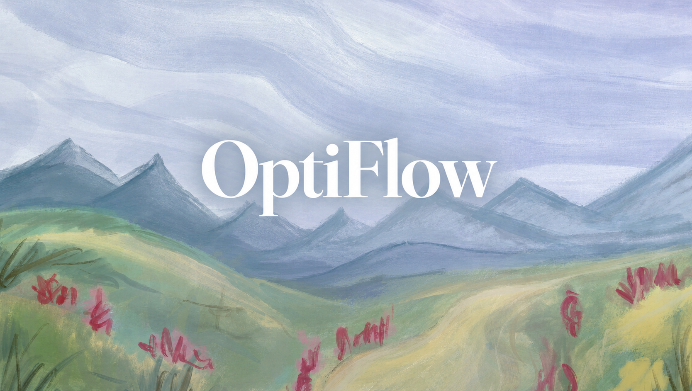
</picture>

> **A moment to notice how you're doing.**  
> Camera-assisted wellness check-ins, processed entirely on your device. Visible facial movement, your own reports of energy and stress, and a calm next step — never a diagnosis, never a saved video.

---

## What OptiFlow is

OptiFlow is a local-first, camera-assisted wellness check-in app. You open your webcam, sit quietly for 20–120 seconds, and the app observes what the camera sees — blink stability, eye closure, jaw and brow movement, head steadiness — and combines it with your own reports of stress, fatigue, and energy. The result is a gentle, transparent score and a suggested reset (eye rest, paced breathing, a short walk).

**No raw video is ever saved or uploaded.** No microphone is ever requested. Face processing happens in the browser via MediaPipe.

---

## What it measures

| Observation | What it is |
|-------------|------------|
| Blink count & rate | Blinks per minute during the scan |
| Eye closure % | Share of valid time eyes were closed |
| Jaw opening / brow movement | Visible facial movement activity |
| Head steadiness | Yaw, pitch, roll variability |
| Self-report | Your own stress, fatigue, eye, jaw, energy (0–10) |

OptiFlow does **not** claim to detect mental illness, diagnose conditions, read emotions, or assess overall health from appearance. A neutral expression is not unhealthy; smiling is not rewarded.

---

## Feature tour

### Today — your dashboard
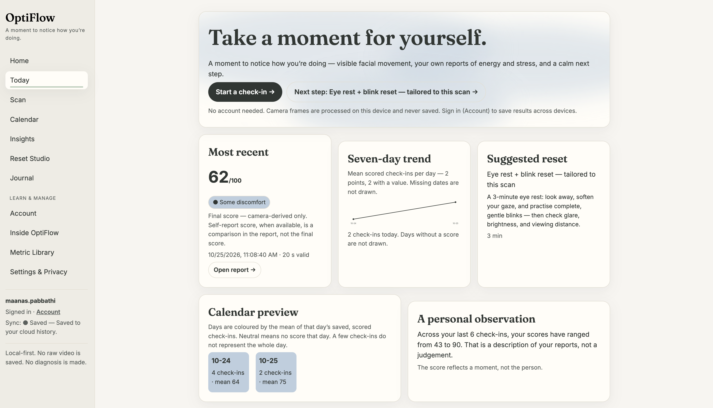

Your most recent score, a seven-day trend, a suggested reset, and a calendar preview — all local to your device.

### Scan — the check-in
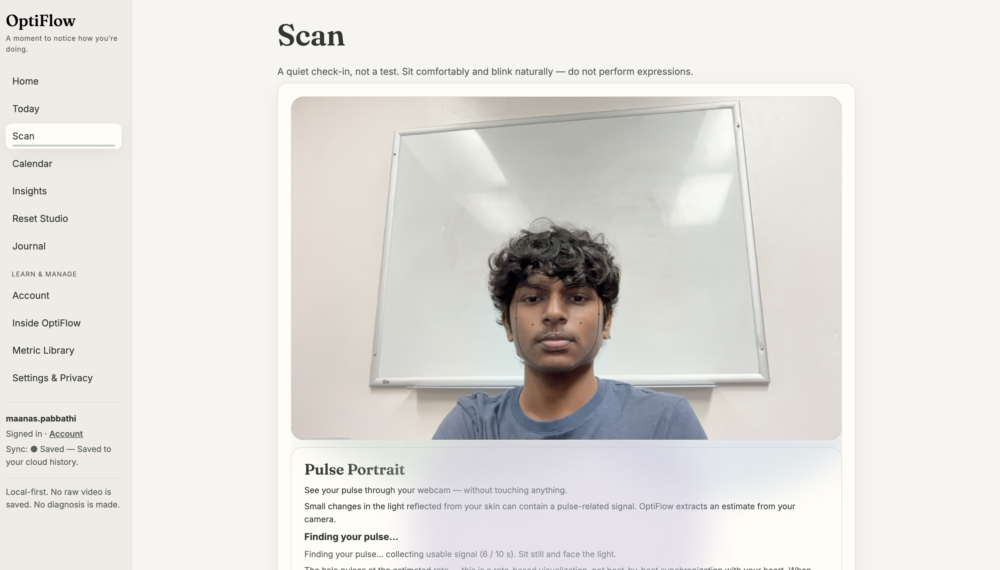

Face landmarks overlaid on your webcam feed. Blinks, eye openness, brow movement, jaw opening, and tension tracked in real time.

### Pulse Portrait — rPPG from your webcam
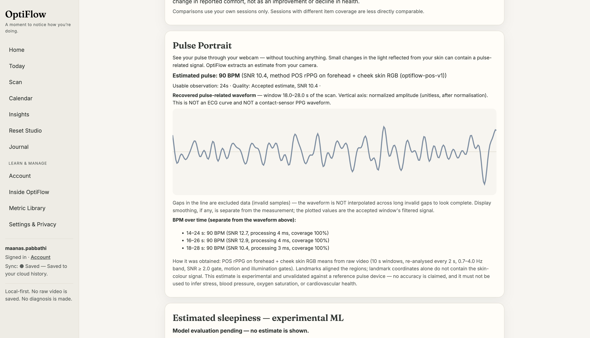

Estimated pulse from subtle skin-light changes. Experimental and unvalidated — not an ECG or contact-sensor PPG.

### Report — transparent scoring
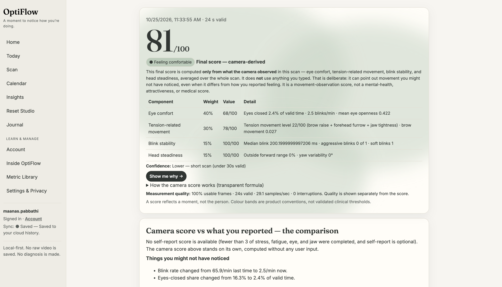

Every score is broken into weighted components (eye comfort, tension-related movement, blink stability, head steadiness) with a transparent formula you can inspect.

### Insights — restrained trends
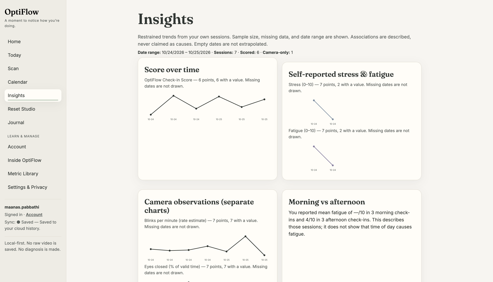

Score over time, self-reported stress & fatigue, camera observations, and morning vs afternoon comparisons. Missing dates are never extrapolated. Associations are described, never claimed as causes.

### Calendar — daily colour code
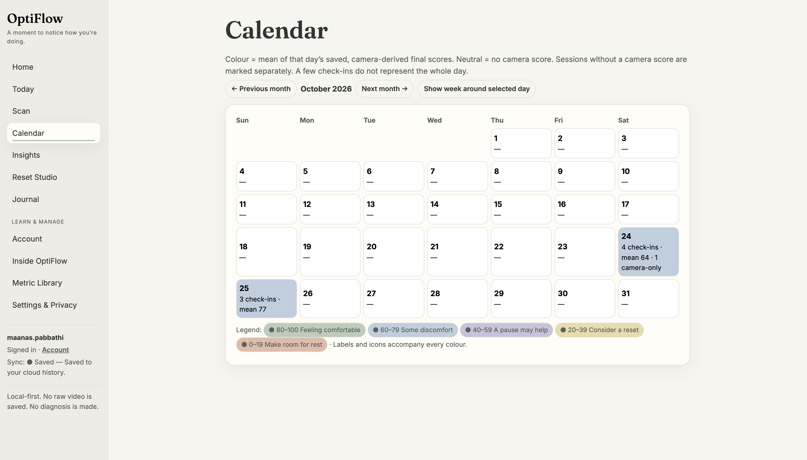

Days coloured by your mean saved score. Neutral = no camera score that day.

### Reset Studio — small, usable activities
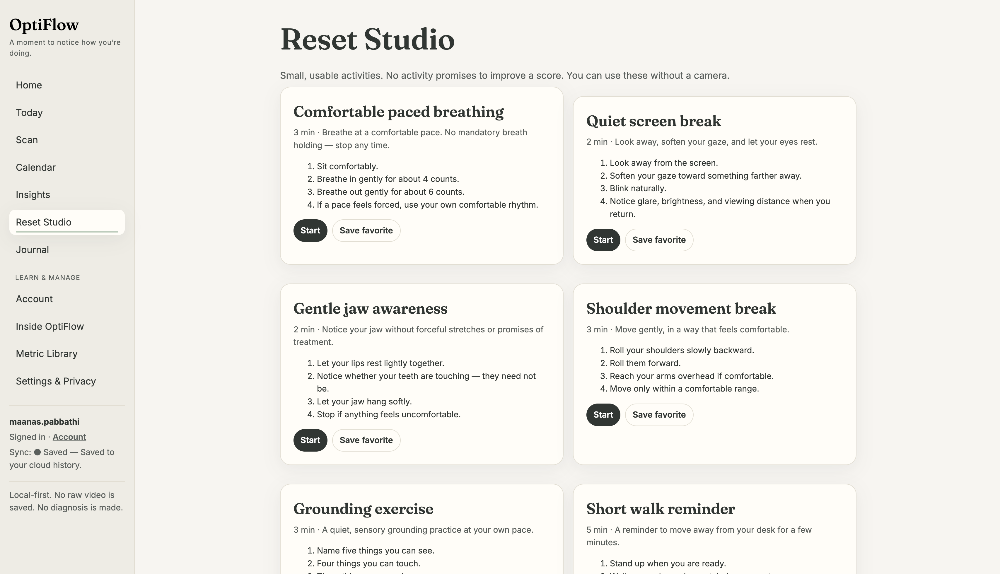

Comfortable paced breathing, quiet screen break, gentle jaw awareness, shoulder movement, grounding exercise, short walk reminder. No camera required.

### Journal — private notes
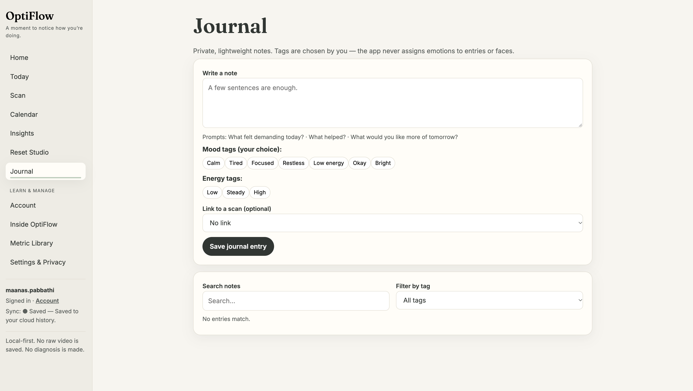

Lightweight private notes with mood and energy tags you choose. The app never assigns emotions to entries or faces.

---

## Privacy by design

- **Frames processed on-device** in the browser; no raw video or face image saved or uploaded
- **MediaPipe model downloaded once** from a CDN at first scan — the only network call during a scan
- **Session summaries, notes, preferences** saved locally in IndexedDB
- **Export** all your summaries as JSON; **delete** all personal data anytime

---

## What this is not

- Not a medical device. Not clinically validated.
- Not "AI certified."
- Not emotion detection. No muscle-tension readings.

It is a **moment to notice how you're doing** — visible movement, your own words, and a calm next step.

---

## Screenshot gallery

  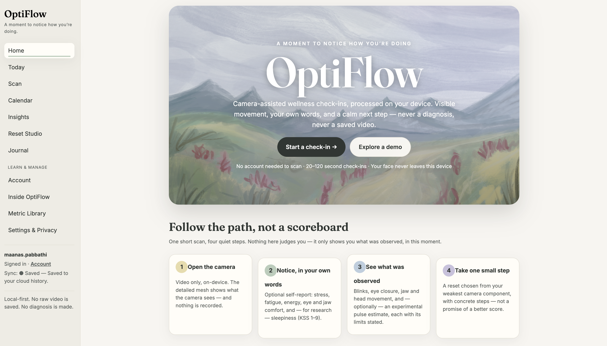
  
  

  
  
  

  
  
  

  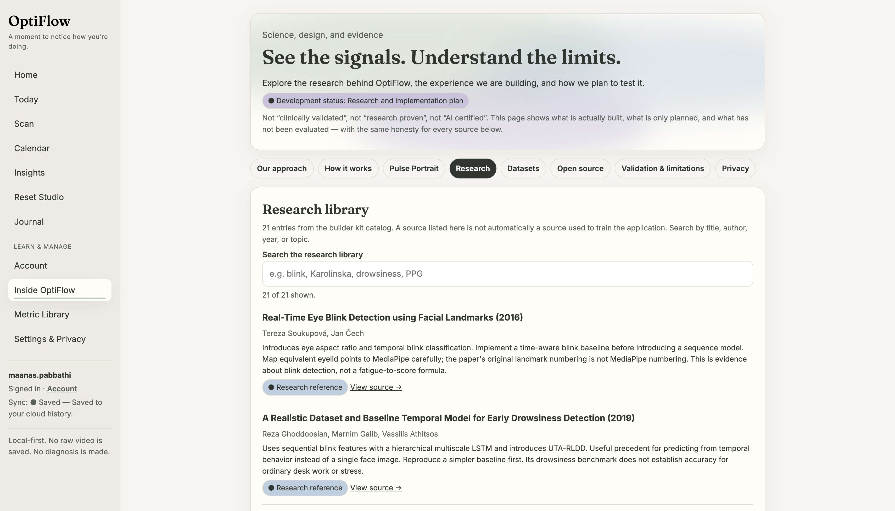
  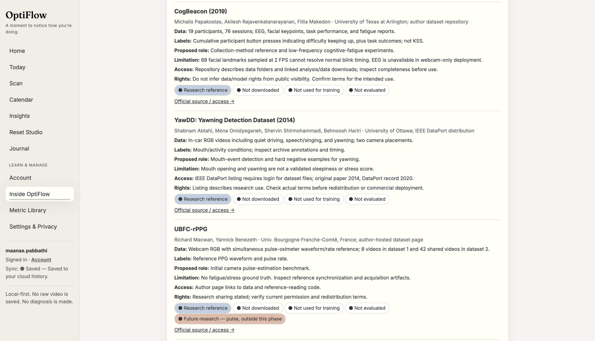
  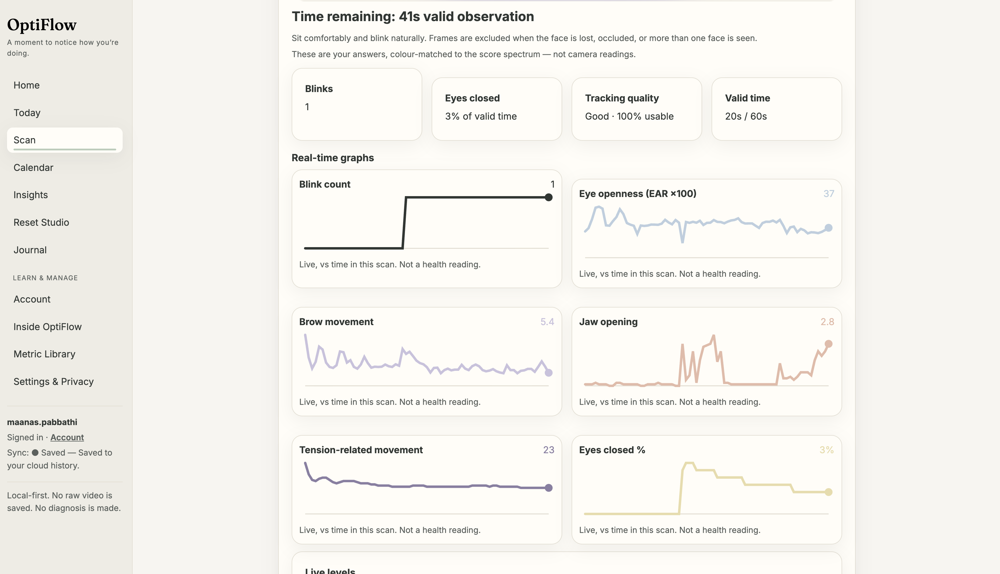

  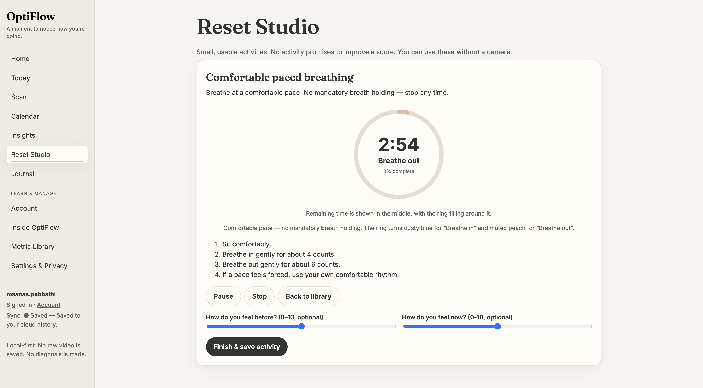
  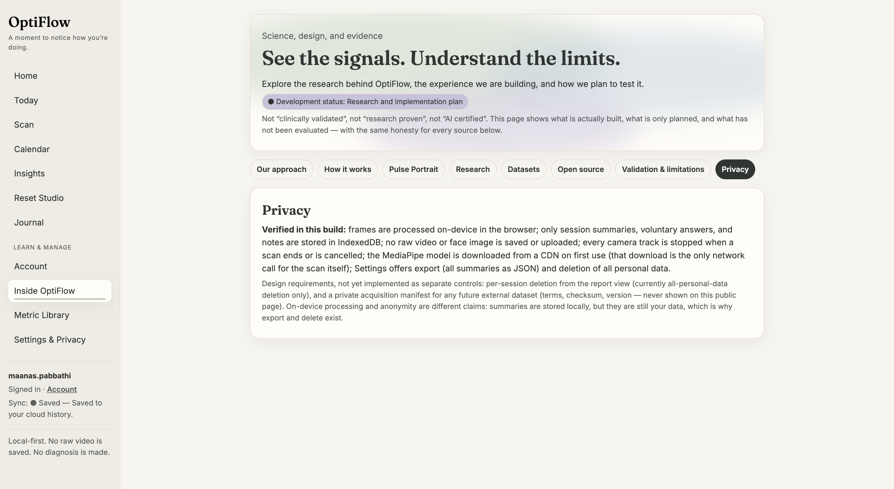

---

## Acknowledgments

- [MediaPipe Face Landmarker](https://developers.google.com/mediapipe/) — on-device face landmark detection
- [React](https://react.dev/) + [Vite](https://vitejs.dev/) — frontend stack

---

## License

MIT. See [LICENSE](LICENSE).

---

*Built with care by Maanas Pabbathi, Rohan Jannu, and Vihan Raval. Camera-assisted wellness, processed on your device.*
